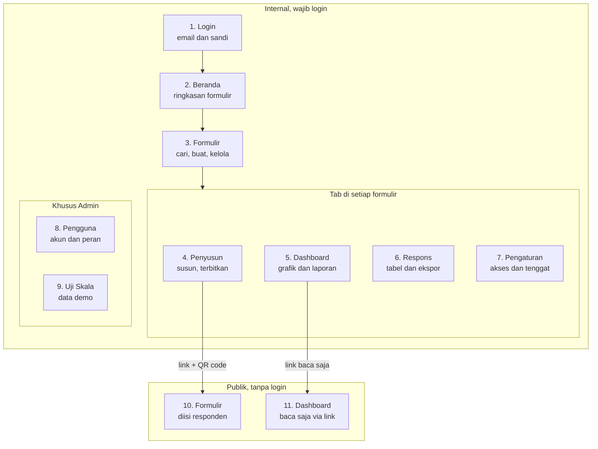

# Laporan Fitur Sharing Vision Form App

Per 16 Oktober 2026

Sharing Vision Form App adalah platform formulir online seperti Google Forms: responden mengisi formulir publik tanpa login, sedangkan tim internal (login) menyusun formulir dan memantau dashboard yang diperbarui langsung. Aplikasi punya 11 halaman, 4 peran, dua bahasa (Indonesia dan Inggris), serta mode terang dan gelap.

## Peran pengguna

Ada tiga peran akun (Admin, Editor, Viewer) yang diatur oleh Admin, ditambah Responden yang mengisi formulir tanpa akun. Selain peran akun, akses tiap formulir diatur per orang: pemilik formulir bisa membagikannya ke rekan sebagai "Bisa melihat" atau "Bisa mengedit".

| Peran     | Login | Siapa              | Yang bisa dilakukan                                                                                                                                                                                                                                                              |
| --------- | ----- | ------------------ | -------------------------------------------------------------------------------------------------------------------------------------------------------------------------------------------------------------------------------------------------------------------------------- |
| Admin     | Ya    | Pengelola aplikasi | Semua yang bisa dilakukan Editor, untuk semua formulir. Membuat akun, mengganti peran, menonaktifkan pengguna. Menghapus formulir dan respons apa pun. Membuka alat demo dan uji skala.                                                                                          |
| Editor    | Ya    | Penyusun formulir  | Membuat formulir (kosong atau dari template), menyusun dan menerbitkannya. Mengedit formulir miliknya dan yang dibagikan sebagai "Bisa mengedit". Melihat dashboard dan respons, menyesuaikan dashboard, membuat grafik sendiri, mengekspor data, membuat link dashboard publik. |
| Viewer    | Ya    | Pembaca laporan    | Hanya membaca dashboard dan respons formulir yang dibagikan kepadanya. Data identitas responden (email/telepon) disamarkan. Tidak bisa mengubah apa pun, meski diberi akses "Bisa mengedit".                                                                                     |
| Responden | Tidak | Publik             | Mengisi formulir lewat link atau QR code. Jawaban tersimpan otomatis di perangkat sampai dikirim. Tidak pernah mengakses database secara langsung.                                                                                                                               |

Pemilik formulir (Editor pembuatnya) dan Admin adalah satu-satunya yang boleh mengatur siapa saja yang mendapat akses ke formulir, serta menghapus respons.

## Peta halaman



Tim internal masuk lewat Login, lalu memilih formulir dan bekerja di empat tabnya. Penyusun menghasilkan link dan QR code untuk responden, sedangkan Dashboard bisa dibagikan sebagai link baca-saja.

## Halaman dan fungsinya

Sembilan halaman untuk tim internal (wajib login) dan dua halaman publik. Semua halaman bisa dibuka di HP.

### 1. Login

Untuk: semua akun internal.

- Masuk dengan email dan kata sandi. Tidak ada pendaftaran mandiri; akun dibuat oleh Admin.
- Ganti bahasa (Indonesia/Inggris) dan tema (terang/gelap).

### 2. Beranda

Untuk: Admin, Editor, Viewer.

- Sapaan dan daftar formulir terbaru yang bisa diakses.
- Tombol "Buat formulir" (Admin dan Editor).

### 3. Daftar Formulir

Untuk: Admin, Editor, Viewer (Viewer hanya melihat formulir yang dibagikan kepadanya).

- Tampilan tabel atau kartu, dengan jumlah respons, respons terakhir, versi, dan penanda "ada perubahan belum terbit".
- Cari judul, filter status, akses (milik saya / dibagikan ke saya) dan pemilik, urutkan (7 pilihan), halaman per halaman.
- Buat formulir baru: kosong atau dari template (Survei Kepuasan Pelanggan, Pendaftaran Acara, Masukan Karyawan).
- Aksi per formulir: buka penyusun, dashboard, pengaturan, duplikat, arsipkan/pulihkan, hapus.

### 4. Penyusun Formulir (Builder)

Untuk: Admin, Editor dengan akses edit.

- 11 jenis pertanyaan: jawaban singkat, paragraf, pilihan ganda, kotak centang, dropdown, angka, tanggal, rating bintang, skala linear, email, telepon.
- Susun dengan drag & drop, bagi ke beberapa bagian (halaman). Pertanyaan diedit langsung di kartunya; pengaturan lanjutan di panel kanan.
- Pengaturan per pertanyaan: wajib/opsional, deskripsi, placeholder (bawaan "Jawaban Anda"), batas angka/panjang, opsi "Lainnya", tampilan radio atau dropdown dengan pencarian.
- Logika: tampilkan pertanyaan atau bagian hanya jika jawaban sebelumnya memenuhi syarat.
- Simpan otomatis, undo/redo, peringatan jika dua orang mengedit bersamaan, pratinjau, dan daftar masalah yang harus dibereskan sebelum terbit.
- Terbitkan: setiap terbit membuat versi baru (v1, v2, …). Respons lama tetap terikat pada versinya, jadi data lama tidak rusak saat formulir diubah.
- Link publik siap dibagikan, lengkap dengan QR code yang bisa diunduh.

### 5. Dashboard

Untuk: Admin, Editor, Viewer.

- Dibuat otomatis dari pertanyaan formulir dan diperbarui langsung saat respons masuk, tanpa refresh.
- Angka utama: total respons, hari ini, tren 7 hari, tingkat penyelesaian, median waktu pengisian. Grafik respons dari waktu ke waktu, jam sibuk, perangkat, bahasa.
- Satu grafik per pertanyaan dengan "temuan utama" dalam kalimat, plus saran "kemungkinan hubungan" antar pertanyaan.
- Filter: rentang tanggal, versi, perangkat, bahasa, jawaban tertentu; klik batang atau irisan grafik untuk memfilter.
- Setiap grafik bisa ditampilkan sebagai tabel data atau diunduh sebagai PNG.
- Editor/Admin: atur tata letak (geser, ubah ukuran), ganti nama, catatan, jenis grafik, warna, sembunyikan; tambah grafik, tabulasi silang, teks, kartu KPI.
- Editor/Admin: **Buat grafik**, pembuat grafik layar penuh ala Looker/Superset. Pilih jenis grafik (11 jenis: KPI, batang, kolom, garis, area, donat, tabel, pivot, peta panas, sebaran, histogram), tarik kolom ke slot, pilih cara hitung (jumlah, %, rata-rata, median, NPS, CSAT, dll.), filter khusus grafik, pratinjau langsung.
- Ekspor respons ke CSV atau Excel sesuai filter, cetak/simpan PDF, mode presentasi untuk layar TV.
- Editor/Admin: buat link dashboard publik (lihat halaman 11).

### 6. Respons

Untuk: Admin, Editor, Viewer.

- Tabel semua respons: cari di jawaban teks, urutkan (terbaru, terlama, durasi), pilih kolom, filter yang sama dengan dashboard. Tetap lancar untuk puluhan ribu baris.
- Klik baris untuk membuka detail satu respons.
- Hapus respons: hanya pemilik formulir dan Admin; dashboard ikut diperbarui otomatis.
- Ekspor CSV/Excel. Untuk Viewer, email dan telepon responden disamarkan.

### 7. Pengaturan Formulir

Untuk: Admin, Editor dengan akses edit.

- Judul, deskripsi, alamat link (dengan cek ketersediaan), pesan terima kasih, pesan saat formulir ditutup.
- Identitas responden: anonim, email, telepon, atau salah satunya, sehingga satu orang hanya bisa mengirim satu respons.
- Tenggat waktu (WIB); formulir otomatis tertutup setelahnya. Tutup dan buka kembali secara manual.
- Berbagi ke rekan sebagai "Bisa melihat" atau "Bisa mengedit" (hanya pemilik dan Admin).
- Arsipkan (respons tetap disimpan) atau hapus permanen beserta semua respons.

### 8. Kelola Pengguna

Untuk: Admin saja.

- Daftar semua pengguna dengan peran, status, tanggal dibuat.
- Buat pengguna (nama, email, peran, kata sandi awal); bisa langsung login.
- Ubah peran, aktifkan atau nonaktifkan akun. Admin tidak bisa menurunkan atau menonaktifkan dirinya sendiri.

### 9. Uji Skala dan Demo

Untuk: Admin saja, dan hanya jika fitur demo dinyalakan di server.

- Membuat formulir demo, mengisi ribuan sampai ratusan ribu respons sintetis, simulator respons per detik untuk melihat dashboard bergerak langsung.
- Panel performa: waktu server dan waktu tampil dashboard.
- Hapus data demo. Data demo ditandai terpisah dan tidak pernah menyentuh data asli.

### 10. Formulir Publik

Untuk: Responden, tanpa login.

- Dibuka lewat link atau QR code; formulir multi-halaman dengan indikator progres dan logika tampil/sembunyi.
- Jawaban tersimpan otomatis di perangkat; responden bisa melanjutkan nanti.
- Validasi jawaban sebelum kirim, halaman terima kasih, opsi kirim respons lagi.
- Jika diminta, responden mengisi email/telepon dulu agar hanya bisa merespons sekali.
- Perlindungan spam: jebakan bot, tolak pengiriman yang terlalu cepat, batas jumlah kiriman per jaringan.
- Menampilkan pesan khusus jika formulir sudah ditutup atau lewat tenggat.

### 11. Dashboard Publik

Untuk: siapa pun yang memegang link, tanpa login.

- Dashboard versi baca-saja yang diperbarui tiap 10 detik, dengan filter tanggal.
- Tidak pernah menampilkan email/telepon responden; jawaban teks bebas hanya tampil jika diizinkan saat membuat link.
- Link bisa diberi masa berlaku, diganti dengan yang baru, atau dicabut kapan saja.

## Hak akses per halaman

Admin bisa membuka semua halaman untuk semua formulir; Editor dan Viewer hanya untuk formulir miliknya atau yang dibagikan kepadanya.

| Halaman                | Admin                      | Editor                                       | Viewer                      | Responden       |
| ---------------------- | -------------------------- | -------------------------------------------- | --------------------------- | --------------- |
| 1. Login               | Ya                         | Ya                                           | Ya                          | —               |
| 2. Beranda             | Ya                         | Ya                                           | Lihat saja                  | —               |
| 3. Daftar Formulir     | Semua formulir             | Milik sendiri + dibagikan                    | Dibagikan, lihat saja       | —               |
| 4. Penyusun Formulir   | Ya                         | Jika punya akses edit                        | —                           | —               |
| 5. Dashboard           | Ya, bisa diubah            | Lihat; ubah jika punya akses edit            | Lihat dan filter saja       | —               |
| 6. Respons             | Ya, bisa hapus             | Lihat; hapus jika pemilik                    | Lihat, identitas disamarkan | —               |
| 7. Pengaturan Formulir | Ya                         | Jika punya akses edit; berbagi hanya pemilik | —                           | —               |
| 8. Kelola Pengguna     | Ya                         | —                                            | —                           | —               |
| 9. Uji Skala dan Demo  | Ya (jika fitur demo aktif) | —                                            | —                           | —               |
| 10. Formulir Publik    | Ya                         | Ya                                           | Ya                          | Ya              |
| 11. Dashboard Publik   | Ya, dengan link            | Ya, dengan link                              | Ya, dengan link             | Ya, dengan link |

Hak akses dijaga di dua lapis: di aplikasi (menu dan tombol disembunyikan) dan di database (aturan keamanan per baris), sehingga pengguna tidak bisa melewatinya walau mengakses data langsung.

# Sharing Vision Form App

Internal code name: FormPulse (used in identifiers such as the dummy `@formpulse.test` accounts).

Dynamic forms with live, editable dashboards. Respondents fill public forms without an account; internal users (admin, editor, viewer) build forms, read live dashboards, export responses and share read-only dashboard links.

Stack: Next.js 16 (App Router, TypeScript), Tailwind + shadcn/ui, Supabase (Postgres + RLS, Auth, Realtime), TanStack Query, Recharts, react-grid-layout, next-intl (Indonesian default, English), exceljs, Vitest, Playwright.

## Local setup

Requirements: Node.js 22+ (`nvm use`, see `.nvmrc`), pnpm, Docker Desktop.

```bash
nvm use
pnpm install
pnpm db:start                     # local Supabase in Docker (Studio: http://127.0.0.1:54323)
pnpm exec supabase status         # prints the URL and keys for .env.local
cp .env.example .env.local        # fill in the variables below
pnpm db:reset                     # applies supabase/migrations to a fresh database
pnpm seed                         # default workspace + DUMMY accounts
pnpm seed:demo                    # optional: demo survey with 300 generated responses
pnpm dev                          # http://localhost:3000
```

DUMMY accounts (local / staging only, public password): `admin@formpulse.test`, `editor@formpulse.test`, `viewer@formpulse.test`, password `Password123!`.

Full Supabase guide (hosted project, keys, migrations, Auth, Realtime, RLS checks, hardening, troubleshooting): [docs/supabase-setup.md](docs/supabase-setup.md).

## Environment variables

| Variable                               | Required | Exposed to browser | Purpose                                                                                                        |
| -------------------------------------- | -------- | ------------------ | -------------------------------------------------------------------------------------------------------------- |
| `NEXT_PUBLIC_SUPABASE_URL`             | yes      | yes                | Supabase project URL                                                                                           |
| `NEXT_PUBLIC_SUPABASE_PUBLISHABLE_KEY` | yes      | yes                | Publishable key (`sb_publishable_...`); RLS protects the data                                                  |
| `SUPABASE_SECRET_KEY`                  | yes      | **never**          | Secret key (`sb_secret_...`), read only in `src/lib/supabase/admin.ts`; public forms, share links, admin tools |
| `NEXT_PUBLIC_SITE_URL`                 | yes      | yes                | Absolute base URL for public form links, QR codes and dashboard share links                                    |
| `IP_HASH_SALT`                         | yes      | **never**          | Long random string; respondent IPs are stored only as salted HMACs for rate limiting                           |
| `ENABLE_DEMO_TOOLS`                    | no       | no                 | `true` enables `/admin/demo/scale` (demo data, simulator, benchmark panel). Default and production: `false`    |

## Scripts

| Script                                    | What it does                                                                                                                                                                   |
| ----------------------------------------- | ------------------------------------------------------------------------------------------------------------------------------------------------------------------------------ |
| `pnpm dev` / `build` / `start`            | Next.js                                                                                                                                                                        |
| `pnpm lint` / `typecheck` / `format`      | ESLint, `tsc`, Prettier                                                                                                                                                        |
| `pnpm test`                               | Vitest: unit + RLS / RPC integration tests (needs the seeded Supabase from `.env.local`)                                                                                       |
| `pnpm e2e`                                | Playwright (starts `pnpm dev` if nothing is running); the scale test needs `ENABLE_DEMO_TOOLS=true`                                                                            |
| `pnpm seed`                               | Idempotent seed (default workspace + DUMMY accounts); refuses non-local targets without `--allow-remote`                                                                       |
| `pnpm seed:demo [--n 300 --days 30]`      | Demo form "Customer Satisfaction Survey (Demo)" with generated, correlated responses (`is_demo`)                                                                               |
| `pnpm db:dummy-sql`                       | Regenerates `supabase/dummy-data.sql`: dummy accounts, forms (published / two versions / identifier / closed / archived / draft), responses and share links for the SQL editor |
| `pnpm bench:dashboard [--sizes 1000,...]` | Grows the scale demo form to each size and times every dashboard RPC through the API (local only)                                                                              |
| `pnpm check:secrets`                      | After `pnpm build`: fails if `SUPABASE_SECRET_KEY`, `IP_HASH_SALT` or any `sb_secret_` key is in client files                                                                  |
| `pnpm db:start` / `db:reset` / `db:types` | Local Supabase helpers (`db:types` regenerates `src/types/database.ts`)                                                                                                        |

Before merging: `pnpm lint && pnpm typecheck && pnpm test`, and `pnpm e2e` for UI changes.

## Deploy (Vercel + Supabase)

1. **Supabase**: create the project in **Singapore (ap-southeast-1)** and follow [docs/supabase-setup.md](docs/supabase-setup.md) sections 2.1–2.9 (keys, `supabase db push`, Auth invite-only, first admin, Realtime check).
2. **Vercel**: import the repository (framework preset Next.js, install `pnpm install`, build `pnpm build`).
   - **Settings > Functions > Function Region: `sin1` (Singapore)**, next to the database. Every dashboard request makes one or more database round trips; another region adds ~150–250 ms each.
   - **Settings > Environment Variables**: the six variables above for Production (and Preview with a staging project). `NEXT_PUBLIC_SITE_URL` must be the production domain. Keep `ENABLE_DEMO_TOOLS=false` in Production.
   - Node.js 22.x or newer (Settings > General).
   - The export route asks for up to 300 s (`maxDuration = 300`). Check your plan's maximum function duration: a 100k-row export streams for about a minute (see docs/scale-report.md); a lower limit cuts large exports short (export a date range instead).
3. **Auth URLs** in Supabase: Site URL = production domain; redirect URLs = `https://<domain>/**` (+ `https://*-<team>.vercel.app/**` for previews).
4. Deploy, then run the checklist below.

### Post-deploy checklist

- [ ] `https://<domain>/` redirects to `/id/login`; sign-up is not offered; the language switcher works.
- [ ] Sign in as the first admin; Admin > Users lists only real accounts (no `@formpulse.test` users active).
- [ ] Create an editor, sign in as them, create a form from a template, publish it, open the public link in a private window and submit from a phone.
- [ ] The editor's dashboard shows the response within a few seconds (badge "Live").
- [ ] Responses tab: the row is there; Export CSV and XLSX download and open in Excel (Indonesian characters intact).
- [ ] Share > Create link: the link opens in a private window without login, shows no identifiers, and stops working after Revoke.
- [ ] `/id/admin/demo/scale` says demo tools are off.
- [ ] Response headers on an app page include `X-Frame-Options: DENY`, `X-Content-Type-Options: nosniff`, `Referrer-Policy`.
- [ ] Locally against the same commit: `pnpm build && pnpm check:secrets` passes.
- [ ] Supabase: RLS checks from docs/supabase-setup.md 2.8 return no rows; backups / PITR enabled.

## Docs

- [docs/progress.md](docs/progress.md): phase status, decisions, known gaps, manual verification checklists
- [docs/architecture.md](docs/architecture.md): ERD, RLS summary, request flow, dashboard data layer, summaries, export, public links
- [docs/scale-report.md](docs/scale-report.md): measured RPC timings at 1k–100k responses, EXPLAIN ANALYZE, fixes
- [docs/supabase-setup.md](docs/supabase-setup.md): step-by-step Supabase configuration (local and hosted)
