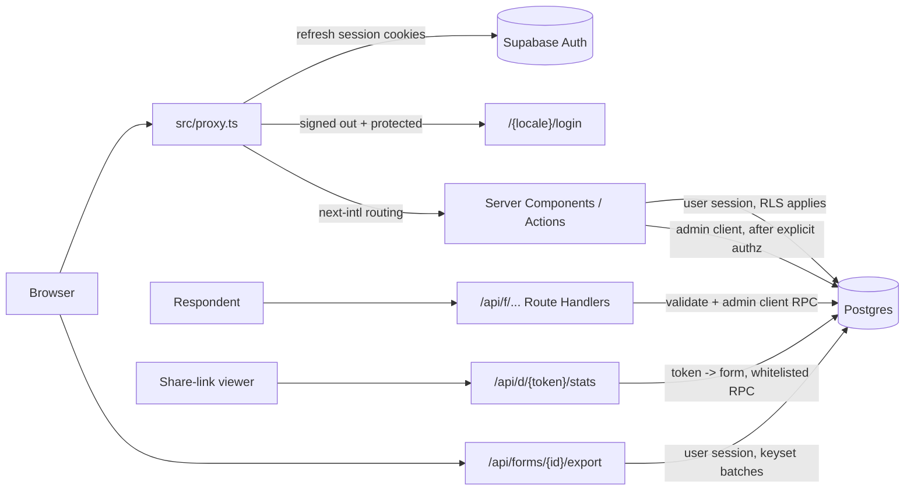
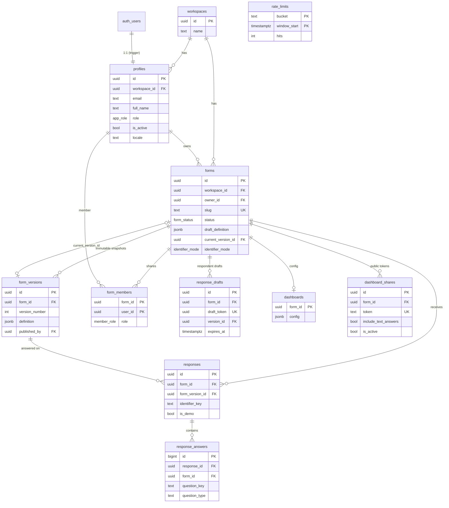
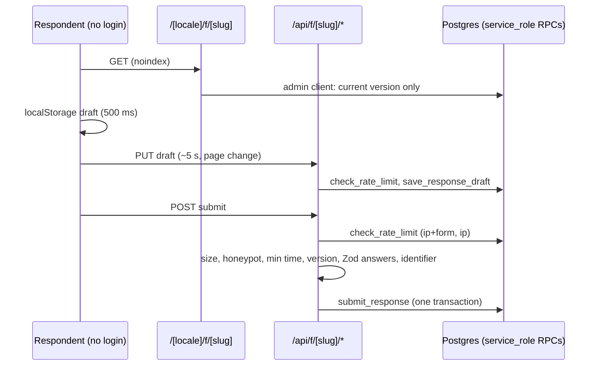
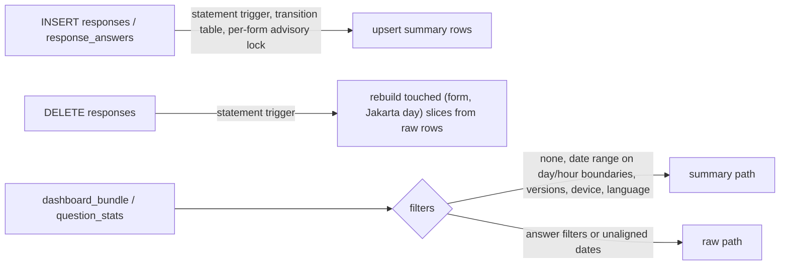
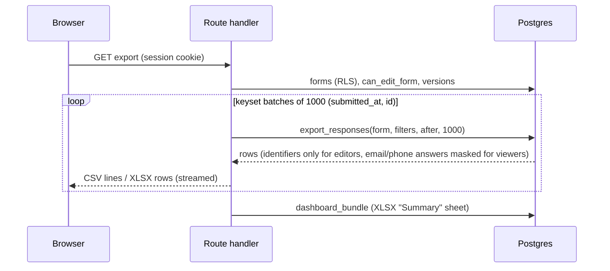

# FormPulse architecture

## Request flow



- `proxy.ts` is a UX gate only. Every page calls `requireUser()` / `requireRole()` (`src/lib/auth/session.ts`), every server action re-checks the caller, and RLS is the final authority.
- Internal users use the cookie-based server client (`src/lib/supabase/server.ts`), so RLS applies.
- The admin client (`src/lib/supabase/admin.ts`, `server-only`) bypasses RLS. It is used only after explicit authorization: admin server actions, the seed script, and later the public `/api/f` handlers.
- Respondents never talk to Supabase directly.

## ERD



Notes:

- `responses (form_version_id, form_id)` and `forms (current_version_id, id)` are composite FKs to `form_versions (id, form_id)`, so a version always belongs to the same form.
- Unique partial index `responses (form_id, identifier_key) where identifier_key is not null and not is_demo` enforces one response per identifier.
- Answers store `question_key` (stable nanoid), never a question position.
- Every key table carries `workspace_id` (directly or through `forms`) for a future multi-tenant migration.

## Permission helpers

All are `SECURITY DEFINER`, `STABLE`, `search_path = ''`, executable by `authenticated` only (never `anon`). Inactive profiles always get `false` / `null`.

| Function                                        | True when                                                                                       |
| ----------------------------------------------- | ----------------------------------------------------------------------------------------------- |
| `is_admin()`                                    | caller is an active admin                                                                       |
| `current_app_role()` / `current_workspace_id()` | caller's role / workspace (active only)                                                         |
| `is_form_owner(form_id)`                        | caller owns the form                                                                            |
| `can_view_form(form_id)`                        | same workspace and (admin, owner, or any `form_members` row)                                    |
| `can_edit_form(form_id)`                        | same workspace and (admin, owner, or `form_members.role = editor` and app role is not `viewer`) |

## RLS summary

RLS is enabled on every table. Policies target `authenticated`; `anon` has no grants at all. `TRUNCATE` is revoked.

| Table                            | SELECT                                                                                   | INSERT                                               | UPDATE                                                 | DELETE                     |
| -------------------------------- | ---------------------------------------------------------------------------------------- | ---------------------------------------------------- | ------------------------------------------------------ | -------------------------- |
| workspaces                       | own workspace                                                                            | —                                                    | —                                                      | —                          |
| profiles                         | own row; admin: whole workspace                                                          | — (auth trigger)                                     | own row (`full_name`, `locale` only); admin: workspace | —                          |
| forms                            | owner (active) or `can_view_form`                                                        | admin/editor, `owner_id = auth.uid()`, own workspace | `can_edit_form` (owner/workspace change: admin only)   | admin or owner             |
| form_versions                    | `can_view_form`                                                                          | — (`publish_form` RPC only)                          | — (immutable trigger)                                  | — (only cascade with form) |
| form_members                     | `can_view_form`                                                                          | `can_edit_form` and (admin or owner)                 | same                                                   | same                       |
| responses                        | `can_view_form`                                                                          | —                                                    | —                                                      | admin or owner             |
| response_answers                 | `can_view_form` (no table grant to `authenticated` since Phase 5: reads go through RPCs) | —                                                    | —                                                      | admin or owner             |
| dashboards                       | `can_view_form`                                                                          | `can_edit_form`                                      | `can_edit_form`                                        | —                          |
| dashboard_shares                 | `can_edit_form`                                                                          | `can_edit_form`                                      | `can_edit_form`                                        | `can_edit_form`            |
| response_drafts                  | —                                                                                        | —                                                    | —                                                      | —                          |
| rate_limits                      | —                                                                                        | —                                                    | —                                                      | —                          |
| response_summary, answer_summary | — (no grants; trigger-maintained, read by SECURITY DEFINER RPCs)                         | —                                                    | —                                                      | —                          |

Triggers:

- `on_auth_user_created` → creates `profiles` (role from `raw_app_meta_data.role`, default `viewer`; full name from user metadata; default workspace).
- `profiles_guard` → non-admin API callers cannot change role, status, workspace or email; admins cannot demote/deactivate themselves.
- `forms_guard` → only admins can change `owner_id` / `workspace_id`; nobody can write `current_version_id` through the API (only `publish_form`). `forms_insert_guard` does the same on insert.
- Check constraint `forms_published_requires_version`: `published` / `closed` forms must have a current version.
- `form_versions_immutable` → blocks UPDATE and DELETE (except the cascade from deleting the form).
- `set_updated_at` on `forms`, `dashboards`, `response_drafts`.

Realtime: `public.responses` is in the `supabase_realtime` publication; RLS still applies to subscribers, and since Phase 4 the identifier columns are not granted to `authenticated`, so payloads omit them.

Why the forms SELECT policy matches the owner directly: `INSERT ... RETURNING` re-checks the SELECT policy on the new row, and `can_view_form()` (STABLE, its own snapshot) cannot see a row inserted by the same statement.

## RPCs (Phase 2)

All `SECURITY DEFINER`, `search_path = ''`, executable by `authenticated` only, with explicit checks inside.

| Function                                                        | Check                                | Purpose                                                                                                                                                                                                                                     |
| --------------------------------------------------------------- | ------------------------------------ | ------------------------------------------------------------------------------------------------------------------------------------------------------------------------------------------------------------------------------------------- |
| `publish_form(form_id, expected_updated_at?)`                   | `can_edit_form`                      | Locks the form, snapshots `draft_definition` into `form_versions` (version = max + 1), sets `current_version_id` and status `published`. 40001 if the draft changed since validation. The server action validates the draft with Zod first. |
| `list_forms(search, status, owner, scope, sort, limit, offset)` | `can_view_form` per row              | One page of forms with response count, last response, version, unpublished-changes flag, caller access and total count, aggregated in SQL.                                                                                                  |
| `list_form_owners()`                                            | `can_view_form`                      | Owner names for the owner filter.                                                                                                                                                                                                           |
| `list_form_members(form_id)`                                    | `can_view_form`                      | Members with email / name (editors cannot read profiles directly).                                                                                                                                                                          |
| `add_form_member(form_id, email, role)`                         | `can_edit_form` and (admin or owner) | Shares with an active user of the same workspace (upsert).                                                                                                                                                                                  |
| `is_slug_available(slug, form_id?)`                             | signed-in active user                | Slug uniqueness check (slugs are public anyway).                                                                                                                                                                                            |

## Respondent flow (Phase 3)



The anon (publishable) key has no table access and cannot execute any of these RPCs; respondents only reach the database through the Route Handlers, which use the admin client after validating input.

| RPC (service_role only)                                 | Purpose                                                                                                                                                                                                    |
| ------------------------------------------------------- | ---------------------------------------------------------------------------------------------------------------------------------------------------------------------------------------------------------- |
| `check_rate_limit(bucket, limit, window_seconds)`       | Fixed-window counter in `rate_limits`; buckets are salted IP hashes.                                                                                                                                       |
| `save_response_draft(form_id, token, version_id, data)` | Upsert draft, expires in 30 days; a token stays bound to its form.                                                                                                                                         |
| `delete_response_draft(form_id, token)`                 | "Start over".                                                                                                                                                                                              |
| `submit_response(...)`                                  | Idempotent by `submission_token`; re-checks status, deadline and version; duplicate check by identifier under a per-form advisory lock; inserts `responses` + typed `response_answers`; deletes the draft. |

Typed answer columns: text types → `value_text`; number / rating / linear_scale → `value_number`; date → `value_date`; choice types → `value_options` (option ids); "Other" text → `value_text`.

## Dashboard data layer (Phase 4)

### Security model

Analytics RPCs are `SECURITY DEFINER`, `search_path = ''`, and start with `_assert_can_view(form_id)`:

- signed-in callers must pass `can_view_form(form_id)` (else SQLSTATE 42501);
- the secret key (`service_role`, no `auth.uid()`) is allowed, so the Phase 5 public dashboard can call the same functions after it has validated a share token;
- `anon` has no EXECUTE on any of them; internal helpers (`_*`) are not executable by any API role.

Why not `SECURITY INVOKER`: RLS would evaluate `can_view_form()` for every `response_answers` row (≈100k rows at 10k responses). One explicit check per call is faster and easier to audit.

Identifiers: `authenticated` can select every `responses` column except `identifier_email`, `identifier_phone`, `identifier_key` and `submission_token` (column privileges). `list_responses` / `get_response` return them in full to users with `can_edit_form` and masked (`a***@example.com`, `***789`) to everyone else. Realtime payloads respect the column grants.

| RPC                                                                                                        | Purpose                                                                                                                                    |
| ---------------------------------------------------------------------------------------------------------- | ------------------------------------------------------------------------------------------------------------------------------------------ |
| `dashboard_bundle(form_id, filters)`                                                                       | Overview + every question's stats in one call (`form`, `overview`, `questions`).                                                           |
| `dashboard_overview(form_id, filters)`                                                                     | Totals, WIB "today" / last 7 vs previous 7 days, previous period, timeline, heatmap, durations, device / language split, funnel, versions. |
| `question_stats(form_id, key, filters)`                                                                    | Type-specific statistics for one question.                                                                                                 |
| `cross_stats(form_id, a, b, filters)`                                                                      | Contingency + Cramér's V, group means, or Pearson r (n ≥ 30).                                                                              |
| `cross_suggestions(form_id, filters)`                                                                      | Up to 4 ranked relationships among current-version candidates.                                                                             |
| `question_text_answers(form_id, key, filters, before_at, before_id, limit)`                                | Latest raw text answers, keyset-paginated.                                                                                                 |
| `list_responses(form_id, filters, search, sort, cursor, limit)`                                            | Responses table: keyset pagination, search, sort, masking.                                                                                 |
| `get_response(response_id)`                                                                                | One response with typed answers (masked for viewers).                                                                                      |
| `generate_demo_responses(form_id, n, days)`, `delete_demo_responses(form_id)`, `analyze_response_tables()` | Demo data, secret key only.                                                                                                                |

Filters (jsonb): `{ from, to, versionIds?, answers: [{ questionKey, operator: "any_of", values }], device?, locale? }`. `to` is exclusive. Every statistic includes `n` and `low_sample` (n < 30).

### Query design and performance

`_dashboard_responses(form_id, filters)` yields the filtered response set (uses `responses (form_id, submitted_at)` for date ranges; answer filters were `NOT EXISTS` probes on `response_answers (response_id)`, set-based since Phase 5). `_bundle_questions` then reads the form's answers once (directly when there are no row filters, otherwise semi-joined to that set), computes counts / averages / quantiles in one hash + ordered-set aggregate pass, and options, pairs, distributions, histograms, dates and terms in a few typed passes, all grouped by `question_key`. Per-question JSON is assembled from those maps. The function runs with `work_mem = 32MB` so the ~100k-row working set and its sorts stay in memory.

Measured locally (Supabase local stack on Docker Desktop for Windows, warm connection, 10 000 responses / 107 384 answers, 14 questions):

| Call                                             | First version  | Final      |
| ------------------------------------------------ | -------------- | ---------- |
| `dashboard_bundle`, no filters                   | 11–30 s        | 380–410 ms |
| `dashboard_bundle`, 30 days + device             | 8.9 s          | 180–200 ms |
| `dashboard_bundle`, answer filter                | 34 s           | 0.7–0.8 s  |
| `cross_suggestions`                              | 91 s           | 0.9–1.0 s  |
| `cross_stats` (one pair)                         | —              | 80–150 ms  |
| `question_stats` (one question)                  | —              | 37–55 ms   |
| `list_responses` (page of 50 / with search)      | 48 ms / 106 ms | same       |
| 300 responses (demo default): `dashboard_bundle` | 82 ms          | < 60 ms    |

EXPLAIN ANALYZE notes:

- First version: `Nested Loop → Bitmap Heap Scan on response_answers (loops=10000)` per question: the `unnest(id array)` join was estimated at 10 rows, so the planner probed `response_answers_response_id_idx` 10 000 times per question, and PL/pgSQL's generic plan after five calls made it worse.
- Final version, unfiltered: one `Seq Scan on response_answers` (≈20 ms for 107k rows) into the materialized answer set; the largest remaining nodes are the hash aggregate over all answers (≈80 ms with timing overhead), the options unnest + aggregate (≈55 ms), the numeric quantiles (`Sort` of 48k numeric answers, ≈35 ms), pairs and terms (≈30 ms each). Cost is linear in the number of answers.
- Without enough `work_mem` the materialized answer set and the ordered-set aggregate spilled to disk (≈100 ms extra); per-function `work_mem = 32MB` fixed it.
- Bulk demo inserts leave stale planner statistics; `seed:demo` calls `analyze_response_tables()`.

Index review: existing indexes cover the access paths (`responses (form_id, submitted_at)`, `response_answers (form_id, question_key)`, `response_answers (response_id)`, `gin (value_options)`, partial identifier indexes from Phase 3). No new indexes were needed: unfiltered statistics read the whole form's answers, where a sequential scan of the matching rows is the cheapest plan. If Phase 5 scale tests miss the target, the next step is pre-aggregated per-question counters maintained by triggers.

### Client data flow

- TanStack Query keys: `["dashboard-bundle", formId, rpcFilters]` (initial data from the server render), `["cross-stats", …]`, `["cross-suggestions", …]` (5 min stale, re-ranked when the total grows ~10%), `["text-answers", …]`, `["responses", …]`.
- Realtime: one channel per open dashboard, joined with the user's JWT (`realtime.setAuth`), INSERT filtered by `form_id`, DELETE unfiltered. Inserts bump the cached total immediately and schedule an invalidation (1.5 s trailing, 5 s max wait). Channel errors switch the bundle query to 10 s polling.
- Dashboard config: `dashboards.config` (zod `dashboardConfigSchema`, `configVersion: 1`), merged with the current definition on every load (`mergeDashboardConfig`), saved 800 ms after the last change through `saveDashboardAction` (RLS: `can_edit_form`).

## Scale, export and public links (Phase 5)

Migration: `supabase/migrations/20261017090000_phase5_scale_export.sql`. Measurements: [scale-report.md](scale-report.md).

### Dashboard summaries

Two tables hold pre-aggregated data, maintained by triggers; nobody but `SECURITY DEFINER` functions can read or write them (RLS on, no policies, no grants to `anon` / `authenticated`).

| Table              | Grain                                                                    | Columns                                                                                             |
| ------------------ | ------------------------------------------------------------------------ | --------------------------------------------------------------------------------------------------- |
| `response_summary` | form × UTC hour × version × device × language                            | `cnt`, `dur_n`, `dur_sum`, `first_at`, `last_at`                                                    |
| `answer_summary`   | form × Asia/Jakarta day × question × version × device × language × value | `kind` (`a` answered, `o` option, `p` checkbox pair, `v` number, `d` date), `value`, `cnt`, `total` |



- Inserts are incremental: the trigger aggregates only the rows of the statement (`new_rows`) with the same SQL text as the rebuild (`_answer_summary_sql()`), so both can never drift. An advisory lock per form serializes concurrent submissions on the same summary rows (no deadlocks).
- Deletes (admin / owner deleting a response, demo cleanup, form deletion) rebuild the affected Jakarta days from the remaining raw rows: the answers are already gone through the cascade when the statement trigger runs, so a decrement is impossible. `rebuild_dashboard_summary(form_id)` (secret key) rebuilds a whole form.
- Read paths: the summary path computes every statistic from value counts (weighted `percentile_cont`, the same numeric formulas as `avg` / `stddev_samp`). The median duration and the top terms still read raw rows (one indexed scan / at most 2,000 answers per question). The raw path is the Phase 4 code. `tests/integration/scale.test.ts` checks that both return identical JSON.
- `cross_suggestions` uses the latest 5,000 matching responses (a hint, cached 5 minutes). `cross_stats` stays exact on the raw rows.
- `_dashboard_responses` resolves answer filters set-based (one indexed read of each filtered question, intersected) instead of a probe per response; `list_responses` no longer materializes an id array.

### Export

`GET /api/forms/:id/export?format=csv|xlsx&ui=<locale>&<dashboard filters>` (signed-in, RLS checks the form).



- Only one batch is in memory. CSV is a pull-based `ReadableStream` (UTF-8 BOM, RFC 4180, CRLF). XLSX uses the exceljs streaming writer; because exceljs ignores backpressure, the writer pauses between batches while more than 2 MB wait unread (`src/lib/export/stream.ts`).
- Columns: response id, submitted at (UTC ISO 8601 and Asia/Jakarta), version, identifier columns (editors only), then one column per question (latest title, short key appended on collisions, current order first, removed questions last). Choice answers use option labels, checkboxes are joined with `; `.
- Formula injection: text cells starting with `=`, `+`, `-`, `@`, tab or CR get a leading `'`.

### Public dashboard links

```mermaid
flowchart LR
  V[Anonymous viewer] --> P["/{locale}/d/{token} page"]
  V --> A["/api/d/{token}/stats?fn=..."]
  P & A --> T{resolveShare: active, not expired, form published}
  T -->|no| N[404 / "link not available"]
  T -->|yes| X["admin client, whitelisted RPC, form id from the share, date range only"]
```

- Tokens: 32 random bytes, base64url (43 characters), generated in Node; regenerate replaces the token, revoke deletes the row. Share rows are managed through server actions as the signed-in user, so RLS (`can_edit_form`) decides who may create or change them.
- The API accepts `fn = bundle | suggestions | cross | text` plus `from` / `to`; the form id never comes from the request. `text` requires `include_text_answers`; without it, text statistics are stripped (`terms`, average length). The bundle's `creator` is removed. Identifiers are never part of these RPCs.
- Rate limit: 600 requests per 10 minutes per IP and token (`check_rate_limit`, salted IP hash). Responses carry `Cache-Control: no-store` and `X-Robots-Tag: noindex`; the page sets `robots: noindex, nofollow`.
- The page renders the same `DashboardView` in `mode="public"`: data source = the share API, 10 s polling (anonymous users cannot use Realtime), date filter only, no drill-down, no editing, export or share controls.

### Dashboard data sources and modes

`DashboardView` takes a `DataSource` (`call(fn, args)`): Supabase as the user (app), the share API (public) or `/api/demo/rpc` (scale page, which also reports server time). Modes: `app` (Realtime, URL filters, editing, share, export, print), `public`, `preview` (scale page: Realtime off during bulk jobs). Realtime INSERT events are buffered and applied at most every 250 ms, so counters re-render at most 4 times per second at any insert rate; charts refetch after 1.5 s of quiet, at most every 5 s.

### Demo tools

`/[locale]/admin/demo/scale`: admin role (layout) **and** `ENABLE_DEMO_TOOLS=true`; every server action and `/api/demo/rpc` re-check both and that the target form has `is_demo = true`. The browser drives long jobs as short calls (PostgREST stops statements after 8 s): generation 1,000 responses per call, cleanup 20,000 per call (oldest first), simulator one call per second (`generate_demo_responses(..., p_live => true)`). Demo forms are hidden from `list_forms` unless `p_include_demo`.

### Security headers

`next.config.ts`: `X-Content-Type-Options: nosniff`, `Referrer-Policy: strict-origin-when-cross-origin`, `Permissions-Policy`, HSTS on every path; `X-Frame-Options: DENY` and `frame-ancestors 'none'` on everything except public forms (`/{locale}/f/...`, embeddable). `poweredByHeader: false`. `pnpm check:secrets` scans a production build for server secrets.

## Form definition and versions

- `src/lib/forms/schema.ts` holds the only Zod schema of a form definition (builder, renderer, server validation, analytics).
- Drafts (`forms.draft_definition`) are always structurally valid; `validateDefinition()` must return no problems to publish.
- Every question has a stable `key`; duplicating a question or a form assigns new keys (`cloneDefinitionWithNewKeys`), editing never changes them.
- Publishing creates an immutable `form_versions` row; old responses keep their `form_version_id`. Answers reference `question_key`, so removing a question from a later version never deletes its old answers.
- The builder autosaves with optimistic concurrency on `forms.updated_at` (conflict dialog), mirrors unsaved edits to localStorage, and compares a stable hash with the current version for the "Unpublished changes" badge.

## Code map

| Concern                                                | Location                                                                                                             |
| ------------------------------------------------------ | -------------------------------------------------------------------------------------------------------------------- |
| Session refresh, auth redirect, locale routing         | `src/proxy.ts`                                                                                                       |
| Current user, `requireUser`, `requireRole`             | `src/lib/auth/session.ts`                                                                                            |
| Role helpers and navigation                            | `src/lib/auth/roles.ts`                                                                                              |
| Supabase clients                                       | `src/lib/supabase/{client,server,admin}.ts`                                                                          |
| i18n config                                            | `src/lib/i18n/`, `messages/`                                                                                         |
| 403 page                                               | `src/app/[locale]/(app)/forbidden.tsx`                                                                               |
| Admin users                                            | `src/app/[locale]/(app)/admin/users/`                                                                                |
| Schema                                                 | `supabase/migrations/`                                                                                               |
| Form definition schema, logic, answer validation       | `src/lib/forms/{schema,logic,validation}.ts`                                                                         |
| Builder operations, templates, hashing                 | `src/lib/forms/{operations,templates,hash}.ts`                                                                       |
| Form server actions, access helper                     | `src/lib/forms/{actions,access}.ts`                                                                                  |
| Builder UI                                             | `src/components/builder/`                                                                                            |
| Form renderer (preview now, live in Phase 3)           | `src/components/renderer/`                                                                                           |
| Forms list, settings, sharing, public link             | `src/components/forms/`                                                                                              |
| Dashboard RPCs, demo generator                         | `supabase/migrations/*phase4*`, `*dashboard*`, `*bundle_questions*`                                                  |
| Auto dashboard, config, merge, filters, insights       | `src/lib/analytics/`                                                                                                 |
| Dashboard UI, charts, live updates                     | `src/components/dashboard/`, `src/components/charts/`                                                                |
| Responses tab                                          | `src/components/responses/`                                                                                          |
| Demo data script                                       | `scripts/seed-demo.ts`                                                                                               |
| Summaries, export RPC, share-safe RPCs, demo tools SQL | `supabase/migrations/20261017090000_phase5_scale_export.sql`                                                         |
| Export (CSV / XLSX)                                    | `src/lib/export/`, `src/app/api/forms/[id]/export/route.ts`                                                          |
| Share links (actions, token resolution, public API)    | `src/lib/shares/`, `src/app/api/d/[token]/stats/route.ts`, `src/app/[locale]/d/[token]/`                             |
| Share dialog, export menu, print                       | `src/components/dashboard/{share-dialog,export-menu,dashboard-grid}.tsx`                                             |
| Scale page, demo actions, timed RPC API                | `src/app/[locale]/(app)/admin/demo/scale/`, `src/components/demo/`, `src/lib/demo/`, `src/app/api/demo/rpc/route.ts` |
| Benchmark, secret scan                                 | `scripts/bench-dashboard.ts`, `scripts/check-client-secrets.mjs`                                                     |
