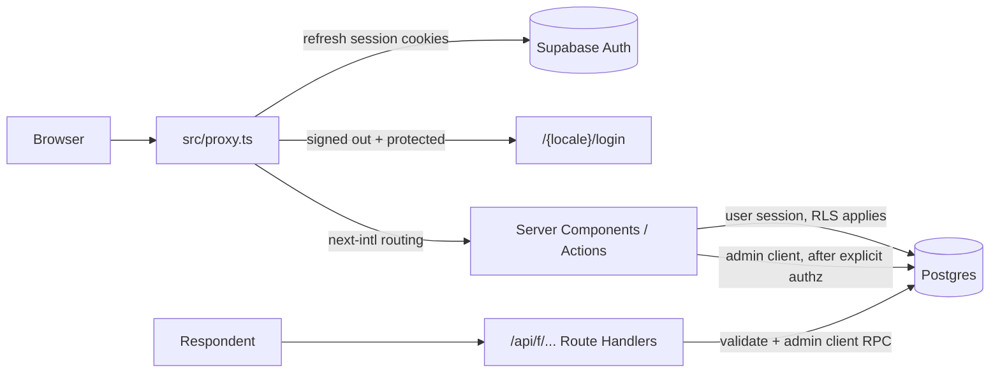
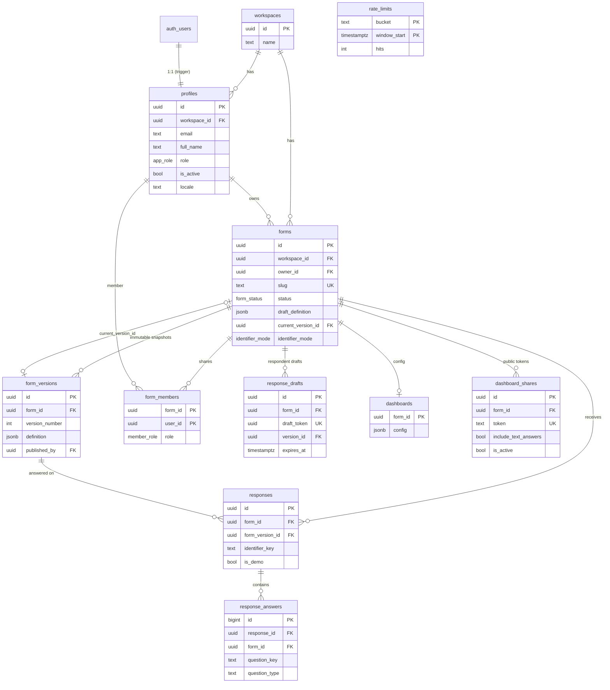
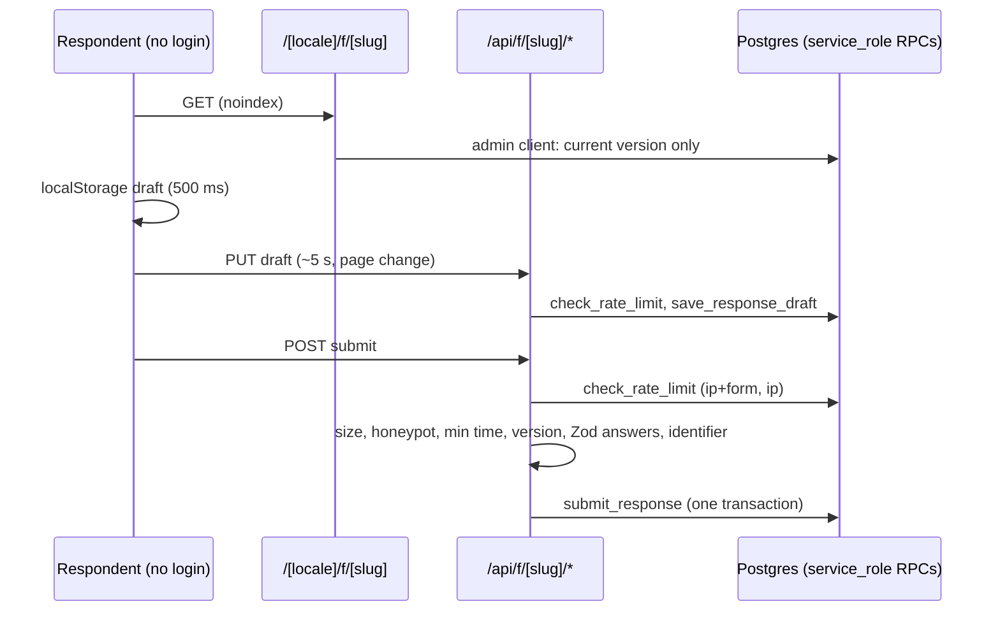

# FormPulse architecture

## Request flow

- `proxy.ts` is a UX gate only. Every page calls `requireUser()` / `requireRole()` (`src/lib/auth/session.ts`), every server action re-checks the caller, and RLS is the final authority.
- Internal users use the cookie-based server client (`src/lib/supabase/server.ts`), so RLS applies.
- The admin client (`src/lib/supabase/admin.ts`, `server-only`) bypasses RLS. It is used only after explicit authorization: admin server actions, the seed script, and later the public `/api/f` handlers.
- Respondents never talk to Supabase directly.

## ERD

Notes:

- `responses (form_version_id, form_id)` and `forms (current_version_id, id)` are composite FKs to `form_versions (id, form_id)`, so a version always belongs to the same form.
- Unique partial index `responses (form_id, identifier_key) where identifier_key is not null and not is_demo` enforces one response per identifier.
- Answers store `question_key` (stable nanoid), never a question position.
- Every key table carries `workspace_id` (directly or through `forms`) for a future multi-tenant migration.

## Permission helpers

All are `SECURITY DEFINER`, `STABLE`, `search_path = ''`, executable by `authenticated` only (never `anon`). Inactive profiles always get `false` / `null`.

| Function                                        | True when                                                                                       |
| ----------------------------------------------- | ----------------------------------------------------------------------------------------------- |
| `is_admin()`                                    | caller is an active admin                                                                       |
| `current_app_role()` / `current_workspace_id()` | caller's role / workspace (active only)                                                         |
| `is_form_owner(form_id)`                        | caller owns the form                                                                            |
| `can_view_form(form_id)`                        | same workspace and (admin, owner, or any `form_members` row)                                    |
| `can_edit_form(form_id)`                        | same workspace and (admin, owner, or `form_members.role = editor` and app role is not `viewer`) |

## RLS summary

RLS is enabled on every table. Policies target `authenticated`; `anon` has no grants at all. `TRUNCATE` is revoked.

| Table            | SELECT                            | INSERT                                               | UPDATE                                                 | DELETE                     |
| ---------------- | --------------------------------- | ---------------------------------------------------- | ------------------------------------------------------ | -------------------------- |
| workspaces       | own workspace                     | —                                                    | —                                                      | —                          |
| profiles         | own row; admin: whole workspace   | — (auth trigger)                                     | own row (`full_name`, `locale` only); admin: workspace | —                          |
| forms            | owner (active) or `can_view_form` | admin/editor, `owner_id = auth.uid()`, own workspace | `can_edit_form` (owner/workspace change: admin only)   | admin or owner             |
| form_versions    | `can_view_form`                   | — (`publish_form` RPC only)                          | — (immutable trigger)                                  | — (only cascade with form) |
| form_members     | `can_view_form`                   | `can_edit_form` and (admin or owner)                 | same                                                   | same                       |
| responses        | `can_view_form`                   | —                                                    | —                                                      | admin or owner             |
| response_answers | `can_view_form`                   | —                                                    | —                                                      | admin or owner             |
| dashboards       | `can_view_form`                   | `can_edit_form`                                      | `can_edit_form`                                        | —                          |
| dashboard_shares | `can_edit_form`                   | `can_edit_form`                                      | `can_edit_form`                                        | `can_edit_form`            |
| response_drafts  | —                                 | —                                                    | —                                                      | —                          |
| rate_limits      | —                                 | —                                                    | —                                                      | —                          |

Triggers:

- `on_auth_user_created` → creates `profiles` (role from `raw_app_meta_data.role`, default `viewer`; full name from user metadata; default workspace).
- `profiles_guard` → non-admin API callers cannot change role, status, workspace or email; admins cannot demote/deactivate themselves.
- `forms_guard` → only admins can change `owner_id` / `workspace_id`; nobody can write `current_version_id` through the API (only `publish_form`). `forms_insert_guard` does the same on insert.
- Check constraint `forms_published_requires_version`: `published` / `closed` forms must have a current version.
- `form_versions_immutable` → blocks UPDATE and DELETE (except the cascade from deleting the form).
- `set_updated_at` on `forms`, `dashboards`, `response_drafts`.

Realtime: `public.responses` is in the `supabase_realtime` publication; RLS still applies to subscribers.

Why the forms SELECT policy matches the owner directly: `INSERT ... RETURNING` re-checks the SELECT policy on the new row, and `can_view_form()` (STABLE, its own snapshot) cannot see a row inserted by the same statement.

## RPCs (Phase 2)

All `SECURITY DEFINER`, `search_path = ''`, executable by `authenticated` only, with explicit checks inside.

| Function                                                        | Check                                | Purpose                                                                                                                                                                                                                                     |
| --------------------------------------------------------------- | ------------------------------------ | ------------------------------------------------------------------------------------------------------------------------------------------------------------------------------------------------------------------------------------------- |
| `publish_form(form_id, expected_updated_at?)`                   | `can_edit_form`                      | Locks the form, snapshots `draft_definition` into `form_versions` (version = max + 1), sets `current_version_id` and status `published`. 40001 if the draft changed since validation. The server action validates the draft with Zod first. |
| `list_forms(search, status, owner, scope, sort, limit, offset)` | `can_view_form` per row              | One page of forms with response count, last response, version, unpublished-changes flag, caller access and total count, aggregated in SQL.                                                                                                  |
| `list_form_owners()`                                            | `can_view_form`                      | Owner names for the owner filter.                                                                                                                                                                                                           |
| `list_form_members(form_id)`                                    | `can_view_form`                      | Members with email / name (editors cannot read profiles directly).                                                                                                                                                                          |
| `add_form_member(form_id, email, role)`                         | `can_edit_form` and (admin or owner) | Shares with an active user of the same workspace (upsert).                                                                                                                                                                                  |
| `is_slug_available(slug, form_id?)`                             | signed-in active user                | Slug uniqueness check (slugs are public anyway).                                                                                                                                                                                            |

## Respondent flow (Phase 3)

The anon (publishable) key has no table access and cannot execute any of these RPCs; respondents only reach the database through the Route Handlers, which use the admin client after validating input.

| RPC (service_role only)                                 | Purpose                                                                                                                                                                                                    |
| ------------------------------------------------------- | ---------------------------------------------------------------------------------------------------------------------------------------------------------------------------------------------------------- |
| `check_rate_limit(bucket, limit, window_seconds)`       | Fixed-window counter in `rate_limits`; buckets are salted IP hashes.                                                                                                                                       |
| `save_response_draft(form_id, token, version_id, data)` | Upsert draft, expires in 30 days; a token stays bound to its form.                                                                                                                                         |
| `delete_response_draft(form_id, token)`                 | "Start over".                                                                                                                                                                                              |
| `submit_response(...)`                                  | Idempotent by `submission_token`; re-checks status, deadline and version; duplicate check by identifier under a per-form advisory lock; inserts `responses` + typed `response_answers`; deletes the draft. |

Typed answer columns: text types → `value_text`; number / rating / linear_scale → `value_number`; date → `value_date`; choice types → `value_options` (option ids); "Other" text → `value_text`.

## Form definition and versions

- `src/lib/forms/schema.ts` holds the only Zod schema of a form definition (builder, renderer, server validation, analytics).
- Drafts (`forms.draft_definition`) are always structurally valid; `validateDefinition()` must return no problems to publish.
- Every question has a stable `key`; duplicating a question or a form assigns new keys (`cloneDefinitionWithNewKeys`), editing never changes them.
- Publishing creates an immutable `form_versions` row; old responses keep their `form_version_id`. Answers reference `question_key`, so removing a question from a later version never deletes its old answers.
- The builder autosaves with optimistic concurrency on `forms.updated_at` (conflict dialog), mirrors unsaved edits to localStorage, and compares a stable hash with the current version for the "Unpublished changes" badge.

## Code map

| Concern                                          | Location                                       |
| ------------------------------------------------ | ---------------------------------------------- |
| Session refresh, auth redirect, locale routing   | `src/proxy.ts`                                 |
| Current user, `requireUser`, `requireRole`       | `src/lib/auth/session.ts`                      |
| Role helpers and navigation                      | `src/lib/auth/roles.ts`                        |
| Supabase clients                                 | `src/lib/supabase/{client,server,admin}.ts`    |
| i18n config                                      | `src/lib/i18n/`, `messages/`                   |
| 403 page                                         | `src/app/[locale]/(app)/forbidden.tsx`         |
| Admin users                                      | `src/app/[locale]/(app)/admin/users/`          |
| Schema                                           | `supabase/migrations/`                         |
| Form definition schema, logic, answer validation | `src/lib/forms/{schema,logic,validation}.ts`   |
| Builder operations, templates, hashing           | `src/lib/forms/{operations,templates,hash}.ts` |
| Form server actions, access helper               | `src/lib/forms/{actions,access}.ts`            |
| Builder UI                                       | `src/components/builder/`                      |
| Form renderer (preview now, live in Phase 3)     | `src/components/renderer/`                     |
| Forms list, settings, sharing, public link       | `src/components/forms/`                        |
